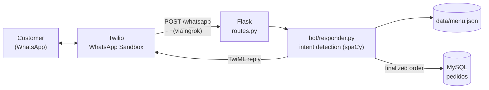

# Intelligent Customer Service Chatbot

- This project presents the development of an intelligent chatbot designed for automated customer service. The system interprets user messages and provides responses to common questions, while managing simple orders in an organized manner.

## Key Features

- Implemented in Python using the Flask framework to manage communication between the user and the server.

- Utilizes Natural Language Processing (NLP) to identify user intents in text messages.

- MySQL database integration, recording every finalized order.

- WhatsApp integration via Twilio, simulating real communication interactions.

- Modular code structure, separating message processing, routes, database handling, and utility functions.

## Project Objectives

- Demonstrate how Artificial Intelligence and NLP can be applied in customer service systems.

- Develop a prototype capable of responding to basic commands such as viewing the menu, adding items to an order, finalizing orders, and checking opening hours.

- Serve as a reference for future projects aiming to implement simple customer service chatbots.

## How it works



| The customer sends | Intent | The bot answers |
|---|---|---|
| "oi", "olá" | greeting | welcome message |
| "menu", "cardápio" | show menu | items and prices from `data/menu.json` |
| a number (`1`, `2`...) | add item | adds that item to the customer's cart |
| "pedido", "carrinho" | show order | items in the cart and the total |
| "finalizar", "fechar" | finalize order | saves the order in MySQL and empties the cart |
| "horário" | opening hours | the hours and whether the store is open now |

Intents are detected with spaCy's Portuguese model (`pt_core_news_sm`): the message is lemmatized and each word's lemma is compared with the keywords of each intent.

## Tech stack

Python · Flask · spaCy · Twilio (WhatsApp) · MySQL · ngrok

## Project structure

```text
├── app.py              starts the Flask server
├── routes.py           /whatsapp endpoint called by Twilio
├── config.py           opening hours and days
├── bot/
│   ├── responder.py    intent detection and replies
│   ├── database.py     MySQL connection and order saving
│   └── utils.py        opening hours, greeting
├── data/menu.json      menu items and prices
├── schema.sql          database and table creation
└── test_db.py          checks the MySQL connection
```

## How to run

Requirements: Python 3.10+, MySQL, a [Twilio](https://www.twilio.com/) account (the free WhatsApp Sandbox is enough) and [ngrok](https://ngrok.com/download).

```bash
git clone https://github.com/JoseEnriq/ChatBotTCC.git
cd ChatBotTCC
python -m venv .venv
.venv\Scripts\activate          # Linux/macOS: source .venv/bin/activate
pip install -r requirements.txt
python -m spacy download pt_core_news_sm
```

1. **Database:** run `schema.sql` in MySQL, copy `.env.example` to `.env` and fill in the credentials. `python test_db.py` checks the connection.
2. **Server:** `python app.py` (starts on `http://localhost:5000`; run it from the project folder).
3. **Public URL:** `ngrok http 5000` and copy the `https://...ngrok...` address.
4. **Twilio:** in *Messaging > Try it out > Send a WhatsApp message > Sandbox settings*, set *When a message comes in* to `https://<your-ngrok-address>/whatsapp` (POST).
5. Send the sandbox's join code to the Twilio number on WhatsApp, then send "oi".

## Limitations

- The chatbot is limited to pre-defined intents; messages outside its scope return a standard response.

- Basic prototype without advanced performance metrics or commercial system integration.
